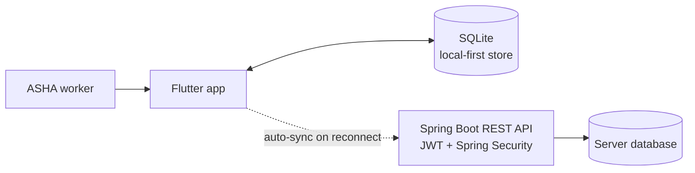
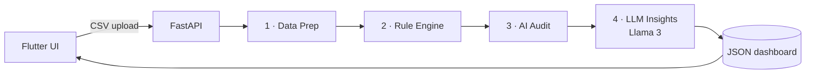

<!--
  Hey curious dev 👀 — you're reading the source.
  Welcome to Rahul's README. Glad you're here.
-->

<div align="center">


# Rahul Temkar

**Flutter × Spring Boot Developer** · building apps that work — even when the internet doesn't 📡


<a href="mailto:rahultemkar61@gmail.com"></a>
<a href="https://www.linkedin.com/in/rahul-temkar-7a53952b3/"></a>
<a href="https://x.com/RahulT_25"></a>


</div>

---

```console
rahul@devbox:~$ neofetch
----------------------------------------------------------------
 User        : Rahul Temkar
 Location    : Maharashtra, India 🇮🇳
 Education   : MCA @ MET, Mumbai ('27, in progress) · BCA ('22–'25)
 Role        : Full Stack App Developer Intern @ GROBIIT
 Shell       : Flutter + Spring Boot
 Toolchain   : Dart · Java · Python · REST · JWT · Spring Security
 Building    : Offline-first healthcare app → Play Store
 Studying    : Clean Architecture patterns in Flutter
 Exploring   : AI in mobile · LLM pipelines · RAG
 Status      : [ONLINE] shipping code 🟢
----------------------------------------------------------------
```

**What I do:** I build mobile apps end to end — Flutter on the device, Spring Boot or FastAPI behind it — with a bias toward apps that keep working on bad networks, secure stateless auth, and AI features that do real work instead of decorating the UI.

---

## ░▒▓ STACK ▓▒░

| Layer | Tools |
|---|---|
| **Mobile** |   |
| **Backend** |      |
| **AI / Data** |     |
| **Databases** |      |
| **Deploy** |   |
| **Tooling** |      |

---

## ░▒▓ FEATURED WORK ▓▒░

### 🏥 01 · Offline-First Healthcare App &nbsp;  

> *"The internet is a privilege. Healthcare is not."*

Built for **ASHA workers in rural India**. The app keeps full functionality with zero connectivity — patient records live in local SQLite first, and sync to a Spring Boot backend automatically when the network comes back.



<details>
<summary><b>Engineering details</b></summary>
<br/>

| Area | Implementation |
|---|---|
| 🔐 **Auth** | Stateless JWT — no server-side sessions |
| 📋 **Records** | Patient CRUD with local-first persistence |
| 📴 **Offline** | Every core flow works with zero internet |
| 🔄 **Sync** | Pushes queued local changes to the server on reconnect |
| 🖼️ **Media** | Image capture with a local cache |
| 🛡️ **API** | REST endpoints hardened with Spring Security |

</details>

<!-- TODO: add repo link once public → [](https://github.com/Rahul2-5/REPO_NAME) -->

---

### 🤖 02 · AutoAuditor — AI Expense Auditor &nbsp; 

> *"Corporate expenses audited in seconds, not weeks."*

Upload a CSV of corporate transactions; get back a full audit — fraud signals, policy violations, analytics, and plain-English insights from Llama 3 — through a four-phase pipeline.



<details>
<summary><b>Pipeline details</b></summary>
<br/>

| Phase | What happens |
|---|---|
| 📥 **Data Prep** | Dynamic schema detection, cleaning, behavioural tagging |
| 📏 **Rule Engine** | Budget-threshold, duplicate, frequency and missing-document violations |
| 🧠 **AI Audit** | Statistical anomaly detection, risk scoring, fraud-signal correlation |
| 💬 **LLM Insights** | Llama 3 writes natural-language summaries and cost-optimisation tips |
| 📊 **Dashboard** | Executive summary, spending trends, top spenders, category breakdown |

</details>

[](https://github.com/Rahul2-5/AutoAuditor)


---

### 💰 03 · Budget Tracker &nbsp; 

> *Because "where did my money go?" shouldn't be a mystery.*

Track expenses, set budgets and visualise spending — with PIN auth and real-time Firestore sync.

[](https://github.com/Rahul2-5/Budget_Tracker)


---

<details>
<summary><b>More on GitHub</b></summary>
<br/>

- [**Encoder-Decoder-Project-DSA-**](https://github.com/Rahul2-5/Encoder-Decoder-Project-DSA-) — encoding and decoding built on core data-structures and algorithms concepts (Java)

</details>

---

## ░▒▓ ROADMAP ▓▒░

- [x] Ship the offline-first healthcare app MVP
- [x] Build AutoAuditor — AI expense-audit pipeline
- [ ] Play Store launch
- [ ] RAG-based audit chat for AutoAuditor
- [ ] Open-source contributions
- [ ] 30-day commit streak

---

## ░▒▓ JOURNEY ▓▒░

```text
 2022 ──────────── 2023 ──────────── 2024 ──────────── 2025 ──────────── now ──▶
  │                 │                 │                 │                 │
 [BCA]          [First repos]    [Real projects]    [MCA + AI]        [Intern]
 Java &         Git, Java,       Offline health     AutoAuditor:      Full Stack App
 fundamentals   REST APIs        app · Budget       Flutter + LLM     Developer
                                 Tracker            full stack        @ GROBIIT
```

---

## ░▒▓ GITHUB STATS ▓▒░

<p align="center">
  
  
</p>
<p align="center">
  
</p>

<p align="center">
  <picture>
    <source media="(prefers-color-scheme: dark)" srcset="https://raw.githubusercontent.com/Rahul2-5/Rahul2-5/output/github-snake-dark.svg" />
    <source media="(prefers-color-scheme: light)" srcset="https://raw.githubusercontent.com/Rahul2-5/Rahul2-5/output/github-snake.svg" />
    
  </picture>
</p>

---

```console
rahul@devbox:~$ exit
[connection closed] — thanks for visiting. Go build something that matters. 🚀
```
